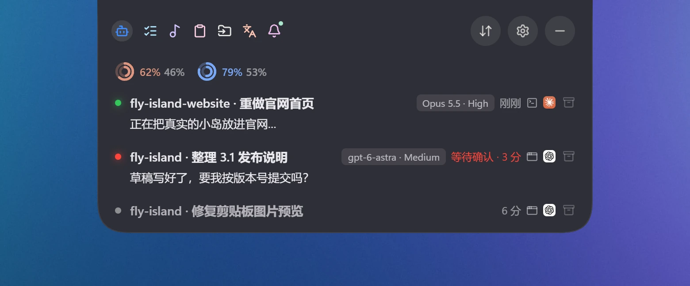
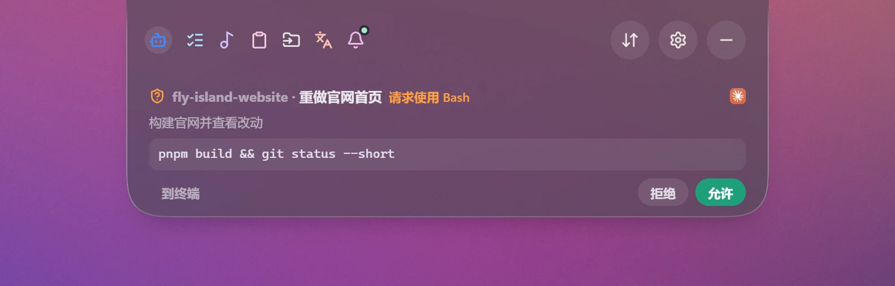
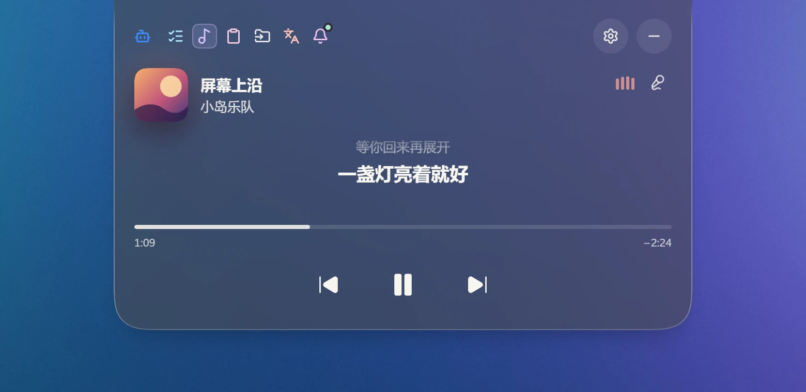
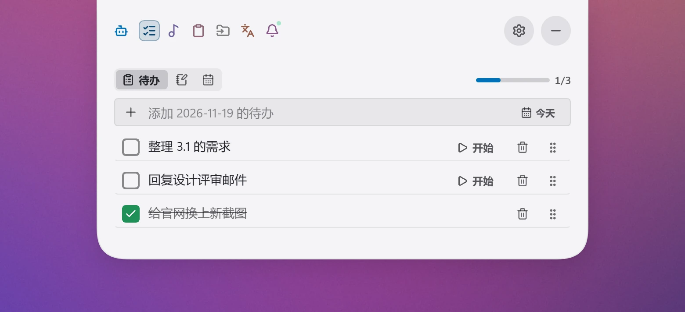
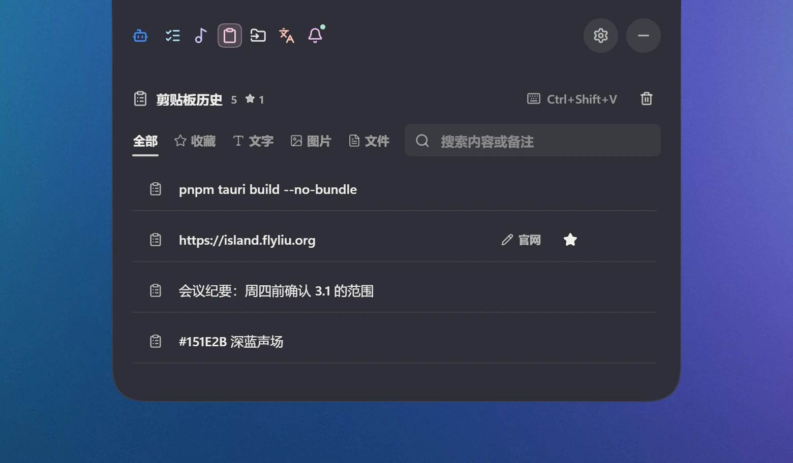
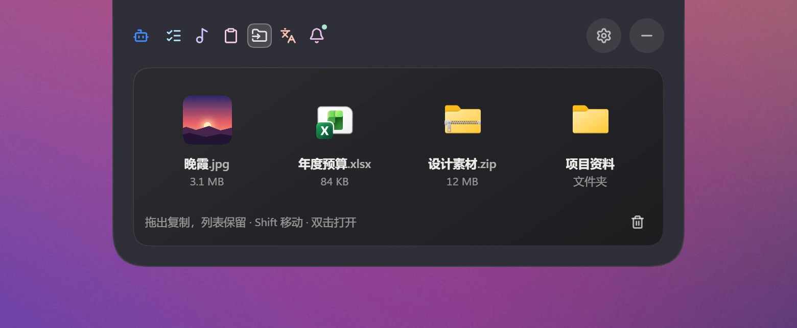
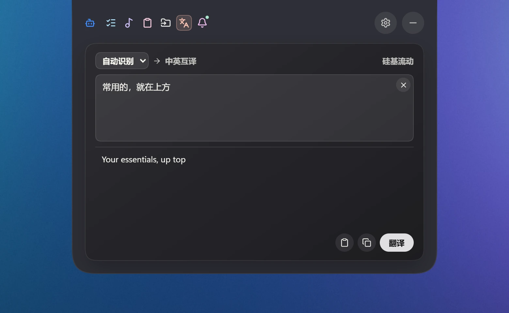
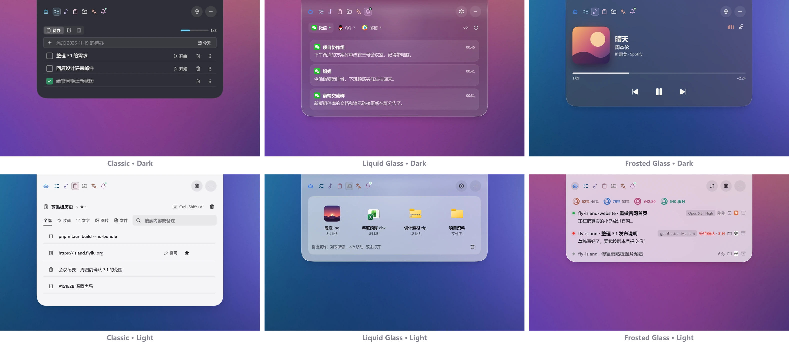
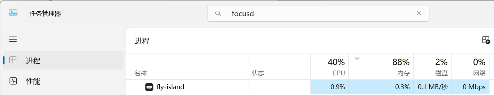

<div align="center">
  

  <h1>fly-island</h1>

  <p>An ultra-lightweight Dynamic Island for Windows: WeChat, QQ and mail messages, multi-session AI agents with quota rings, a music player, to-dos, clipboard history, a file shelf and more. It expands when needed and tucks away when done.</p>

  <p>
    <a href="https://island.flyliu.org/">Live Preview</a>
    ·
    <a href="https://github.com/flyl1u/fly-island/releases/latest">Download Release</a>
    ·
    <a href="https://github.com/flyl1u/fly-island/issues">Report an Issue</a>
    ·
    <a href="#community">Community</a>
    ·
    English · <a href="README.md">中文</a>
  </p>

  <p>
    
    
    
    
    
  </p>

  <a href="https://island.flyliu.org/">
    
  </a>

  <p><sub>Click to open the live preview and try it without installing (video captions are in Chinese)</sub></p>

  <p>If it saves you a few window switches, a ⭐ <b>Star</b> helps more people find it.</p>
</div>

## What is this?

fly-island is a Windows-first Dynamic Island. WeChat, QQ and mail messages pop up right on the island. You can see at a glance what Claude Code, Codex or DSH is doing and whether it needs your approval. Synced lyrics, a file shelf, clipboard history, quick translation and to-dos all live in the same small island at the top of the screen.

It is an ultra-light, frameless, always-on-top island using about 0.2–0.5% of memory. It expands when you need it and tucks away when you are done.

Want to try it first? The [live preview](https://island.flyliu.org/) runs the real island interface with demo data, and you can click around.

## Why I built this

While working or studying I keep a to-do list in one app, music in another to block out noise and a translation site in a third. I copy and paste code all day and still get pulled into group chats. Switching between all of them is slow and distracting.

The iPhone's Dynamic Island gathers notifications, timers and media controls into one small place. I wanted the same for these high-frequency tasks on Windows, in something light enough to keep open all day. That became fly-island.

> The screenshots below show the Chinese interface. The app also has a full English interface.

## Most of the time, it's tiny

When you're not using it, it's just a small pill at the top of the screen showing the song that's playing, unread messages and how many AI agents are working.

<p align="center"></p>

Hover over it and it expands into the views below.

## WeChat, QQ and mail without switching windows

New messages pop up on the island: who sent it and what they said, at a glance. Long messages make the island grow so you can read them in place. Muted group chats only alert you when someone @mentions you.

<p align="center"></p>

## Stop babysitting your AI coding tools

Every Claude Code and Codex session shows up on the island: which one is running, which one is done, which one is waiting for you. Your remaining Claude / Codex quota is there too.

<p align="center"></p>

When an agent wants to run a command or edit a file, click Allow or Deny right on the island.

<p align="center"></p>

## Music and lyrics

Control whatever player you're using: artwork, progress, skip, plus synced lyrics. The current line stays visible even when the island is collapsed.

<p align="center"></p>

## Today's to-dos

Jot down a task, tick it off when done. There's also a daily note, a calendar and a task timer.

<p align="center"></p>

## Everything you copied, still there

Text, images and files you copy are kept in a history you can search and star. Click one to copy it again. Shortcut: `Ctrl+Shift+V`.

<p align="center"></p>

## A shelf for dragging files

Drop files on the island, switch windows, then drag them out where you need them. Handy for moving files between two apps.

<p align="center"></p>

## Quick translation

Press `Ctrl+Shift+F` to translate between Chinese and English automatically. Works out of the box, no sign-up or API key needed.

<p align="center"></p>

## Make it yours

Three looks: Classic, Liquid Glass and Frosted Glass (the glass shows what's behind it), each in dark and light. Size, color, corners and font are adjustable too.

<p align="center"></p>

## Barely there

Don’t worry if it’s always on: in the task manager, fly-island only occupies about 0.3% of the memory (tested on a Windows laptop with about 15GB). When you open the music listening software and download plug-ins, the usage will increase slightly depending on the situation.

<p align="center"></p>

## Install

1. Download `fly-island_<version>_x64-setup.exe` from [Releases](https://github.com/flyl1u/fly-island/releases/latest) and run it.
2. The island appears at the top of your screen. Hover over it to start.
3. Turn on the features you want in Settings. New versions install automatically.

<details>
<summary><b>How do I turn on each feature?</b></summary>

| Feature | How |
| --- | --- |
| WeChat alerts | Just stay signed in to WeChat for PC. [Details](docs/wechat-reminder-compatibility.md) |
| QQ alerts | Stay signed in to QQ and enable system notifications in QQ. [Details](docs/qq-notification-compatibility.md) |
| Mail | Enable IMAP in your mailbox's web settings, get an app password, and enter it in Settings → Mail. [Details](docs/mail.md) |
| AI agents | Click Install in Settings → Agent, then restart your terminal. [Details](docs/agent-status-hooks.md) |
| Translation | Works by default. To use DeepSeek, Qwen, OpenAI and other models, add an API key in Settings → Translation |

</details>

<details>
<summary><b>Is my data safe?</b></summary>

To-dos, clipboard history and settings stay on your own computer. WeChat and QQ messages are only kept in memory and are gone when you quit. Mail bodies are only fetched when you open them, and never marked as read. Passwords and keys are stored in Windows Credential Manager.

</details>

## Community

Scan the QR code with WeChat to join the user group (mostly Chinese-speaking). You can also find it in the app under Settings → About. English feedback is welcome in [Issues](https://github.com/flyl1u/fly-island/issues).

<p align="center"></p>

<p align="center"><sub>The QR code is valid until November 30. If it has expired, please let us know in an <a href="https://github.com/flyl1u/fly-island/issues">Issue</a>.</sub></p>

## Contributing

### Run from source

You need Windows 10/11, Git, Node.js, pnpm, Rust, Visual Studio C++ Build Tools, and the WebView2 Runtime.

```powershell
git clone https://github.com/flyl1u/fly-island.git
cd fly-island
pnpm install
pnpm tauri dev
```

### Submit changes

Run `pnpm check` before committing. See the repository rules in [AGENTS.md](AGENTS.md) and the release steps in the [release guide](docs/updater.md).

### Develop a plugin

Test your plugin locally, then open a PR with a demo recording, the author's name, and contact information. Plugins ship after review. See the [plugin development guide](docs/plugins/README.md).

## Star History

<a href="https://www.star-history.com/?repos=flyl1u%2Ffly-island&type=date&legend=top-left">
  <picture>
    <source media="(prefers-color-scheme: dark)" srcset="https://api.star-history.com/chart?repos=flyl1u/fly-island&type=date&theme=dark&legend=top-left" />
    <source media="(prefers-color-scheme: light)" srcset="https://api.star-history.com/chart?repos=flyl1u/fly-island&type=date&theme=light&legend=top-left" />
    
  </picture>
</a>
