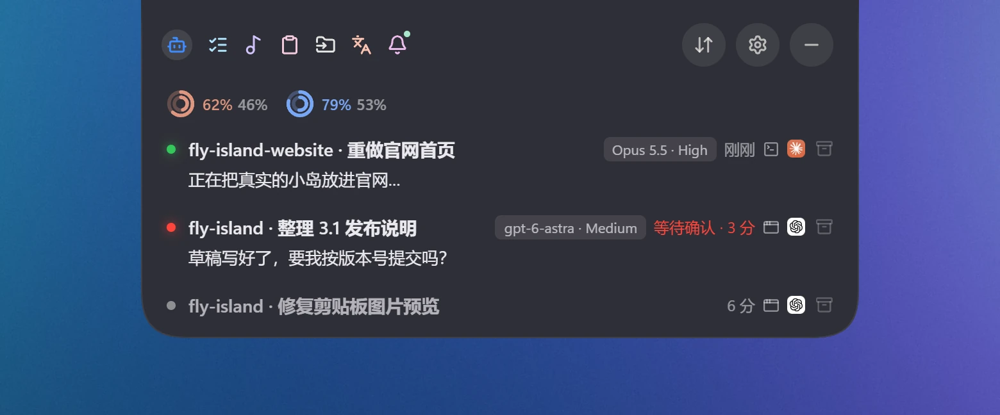
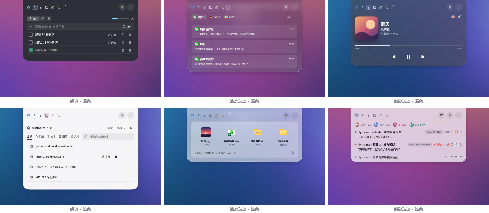

<div align="center">
  

  <h1>fly-island</h1>

  <p>Windows灵动岛：微信、QQ、邮箱消息，多会话 AI Agent 与额度环，音乐播放器、待办、剪贴板、文件中转等常用功能，需要时展开，用完收起。</p>

  <p>
    <a href="https://island.flyliu.org/">在线预览</a>
    ·
    <a href="https://github.com/flyl1u/fly-island/releases/latest">下载 Release</a>
    ·
    <a href="https://github.com/flyl1u/fly-island/issues">反馈 Issue</a>
    ·
    <a href="#用户交流群">用户交流群</a>
    ·
    <a href="README.en.md">English</a> · 中文
  </p>

  <p>
    
    
    
    
    
  </p>

  <a href="https://island.flyliu.org/">
    
  </a>

  <p>如果它帮你少切了几次窗口，欢迎点个 ⭐ <b>Star</b>，让更多人看到它。</p>
</div>  


## 这是什么

fly-island 是一款 Windows 优先的灵动岛。微信、QQ 和邮箱消息直接弹到岛上；Claude Code、Codex、DSH 等 Agent 跑到哪、要不要你审批，一眼就知道；同步歌词、文件中转、剪贴板历史、快捷翻译和待办，也都收在屏幕顶部这座小岛里。

它是一个极轻量、无边框、始终置顶的悬浮岛，内存占用约 0.2%~0.5%，需要时展开，用完收起。

不想安装也可以先玩一下：[在线预览](https://island.flyliu.org/)里是真实的岛屿界面配上演示数据，可以直接点。

## 为什么做它

工作和学习时，我常常要在一个软件里写待办，开着音乐隔绝噪音，查翻译，反复复制粘贴代码，还得时不时看群聊和好友消息。在这些窗口之间来回切换，既慢又分心。

iPhone 的灵动岛把通知、计时、媒体控制收在一个小岛上，缩短了获取信息的路。于是我想：能不能把这些高频功能也收进 Windows 上一个足够轻的地方？fly-island 就这样诞生了。

## 平时它就这么小

不用的时候，它只是屏幕顶部一条小胶囊：显示正在播的歌、未读消息数、正在干活的 AI Agent。

<p align="center"></p>

鼠标移上去，它就展开成下面这些样子。

## 微信、QQ、邮件，不用切窗口就能看

新消息直接弹到岛上，谁发的、说了什么，一眼看完。长消息会把岛撑大，在岛上就能读完。设了免打扰的群，只在有人 @你 时才提醒。

<p align="center"></p>

## AI 写代码时，不用一直盯着终端

Claude Code、Codex 等 AI 工具的每个会话都会显示在岛上：哪个在跑、哪个做完了、哪个在等你回话。还能看到 Claude / Codex 的剩余额度。

<p align="center"></p>

AI 要执行命令、改文件时，直接在岛上点「允许」或「拒绝」。

<p align="center"></p>

## 听歌看歌词

正在用的播放器都能在岛上控制：封面、进度、切歌，还有同步歌词。收起时也会显示当前那一句。

<p align="center"></p>

## 今天要做的事

随手记一条待办，做完打个勾。也能写每日笔记、看日历、给任务计时。

<p align="center"></p>

## 复制过的东西都找得回来

复制过的文字、图片、文件都会记下来，可以搜索、收藏，点一下就能再复制。快捷键 `Ctrl+Shift+V`。

<p align="center"></p>

## 拖文件的中转站

把文件拖到岛上先放着，切到别的窗口再拖出去。在两个窗口之间搬文件时特别顺手。

<p align="center"></p>

## 随手翻译

按 `Ctrl+Shift+F` 呼出，中英文自动互译。不用注册、不用填密钥就能用。

<p align="center"></p>

## 换个样子

三种质感：经典、液态玻璃、磨砂玻璃（玻璃会透出身后的画面），每种都有深色和浅色。大小、颜色、圆角、字体也都能调。

<p align="center"></p>

## 几乎不占资源

一直开着也不用心疼：在任务管理器里，fly-island 只占 0.3% 左右的内存（在一台约15GB的Windows笔记本上的测试），当打开听歌软件、下载插件时，占用会视情况稍微变高

<p align="center"></p>

## 下载安装

到 [Releases](https://github.com/flyl1u/fly-island/releases/latest) 下载 `fly-island_版本号_x64-setup.exe`，双击安装。

<details>
<summary><b>各功能怎么打开？</b></summary>

| 功能 | 怎么开 |
| --- | --- |
| 微信提醒 | 电脑版微信登录着就行。[详细说明](docs/wechat-reminder-compatibility.md) |
| QQ 提醒 | QQ 登录着，并在 QQ 里打开系统通知。[详细说明](docs/qq-notification-compatibility.md) |
| 邮箱 | 在邮箱网页里开启 IMAP、拿到授权码，填到「设置 → 邮箱」。[详细说明](docs/mail.md) |
| AI Agent | 「设置 → Agent」里点安装，然后重开一次终端。[详细说明](docs/agent-status-hooks.md) |
| 翻译 | 默认就能用；想用 DeepSeek、通义千问等大模型，在「设置 → 翻译」填 API 密钥 |

</details>

<details>
<summary><b>我的数据安全吗？</b></summary>

待办、剪贴板、设置都只存在你自己的电脑上。微信和 QQ 消息只在内存里，关掉就没了；邮件只在你点开时才读取正文，不会把邮件标成已读；密码和密钥存放在 Windows 自带的凭据管理器里。

</details>

## 用户交流群

用微信扫码加入用户群，聊使用体验、反馈问题。应用里「设置 → 关于」也能找到这个二维码。

<p align="center"></p>

<p align="center"><sub>二维码 11 月 30 日前有效，失效了请在 <a href="https://github.com/flyl1u/fly-island/issues">Issue</a> 里说一声。</sub></p>

## 参与开发

### 从源码运行

开发环境需要 Windows 10/11、Git、Node.js、pnpm、Rust、Visual Studio C++ Build Tools 和 WebView2 Runtime。

```powershell
git clone https://github.com/flyl1u/fly-island.git
cd fly-island
pnpm install
pnpm tauri dev
```

### 提交代码

提交前运行 `pnpm check`。仓库规则和发布步骤分别见 [AGENTS.md](AGENTS.md) 和[发布指南](docs/updater.md)。

### 开发插件

在本地测试插件后提交 PR，附上演示录屏、作者和联系方式。插件经审核后上线，具体流程见[插件开发规范](docs/plugins/README.md)。

## Star History

<a href="https://www.star-history.com/?repos=flyl1u%2Ffly-island&type=date&legend=top-left">
  <picture>
    <source media="(prefers-color-scheme: dark)" srcset="https://api.star-history.com/chart?repos=flyl1u/fly-island&type=date&theme=dark&legend=top-left" />
    <source media="(prefers-color-scheme: light)" srcset="https://api.star-history.com/chart?repos=flyl1u/fly-island&type=date&theme=light&legend=top-left" />
    
  </picture>
</a>
