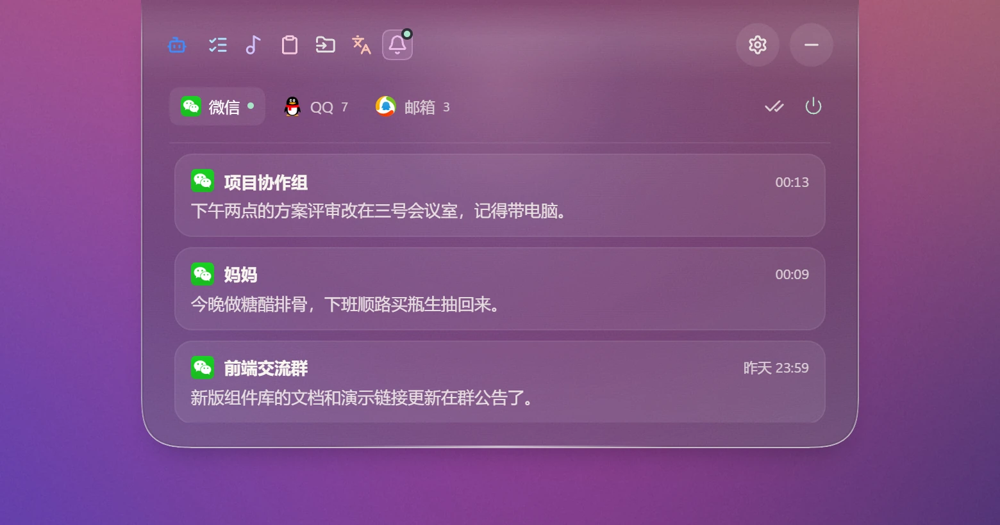
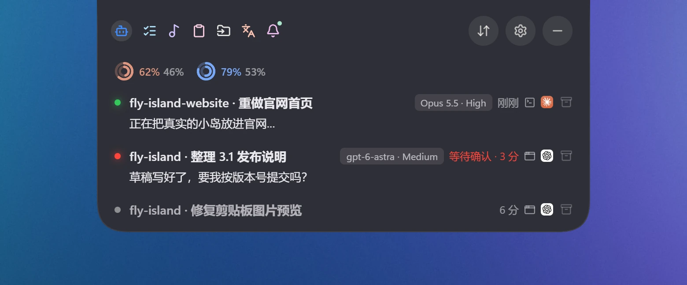
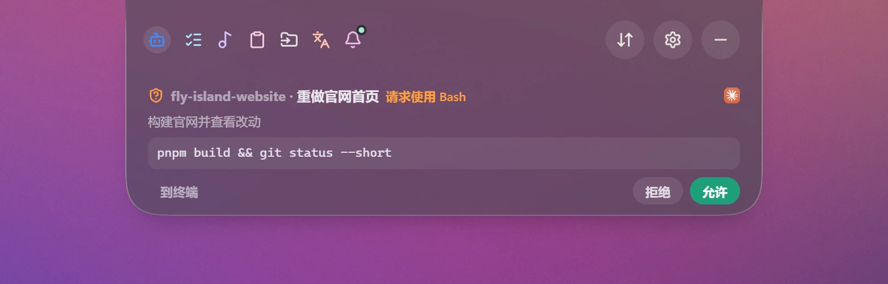
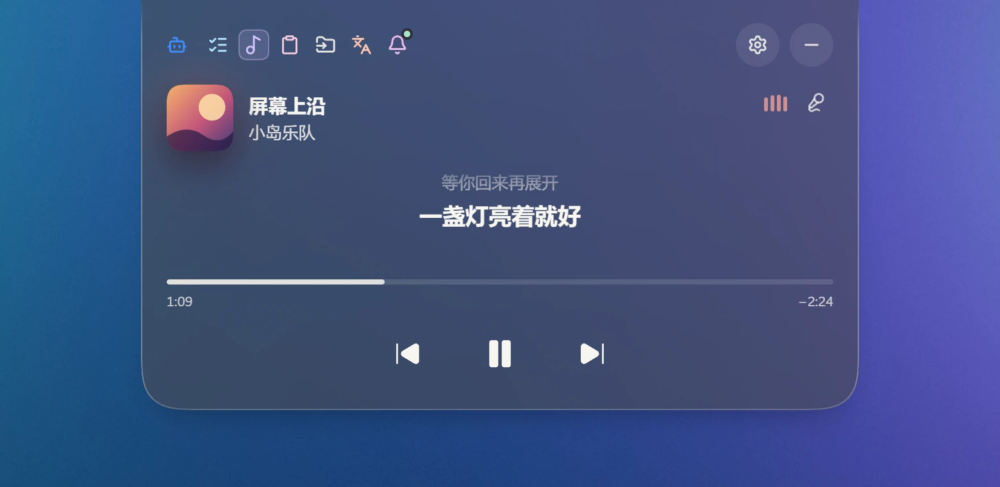
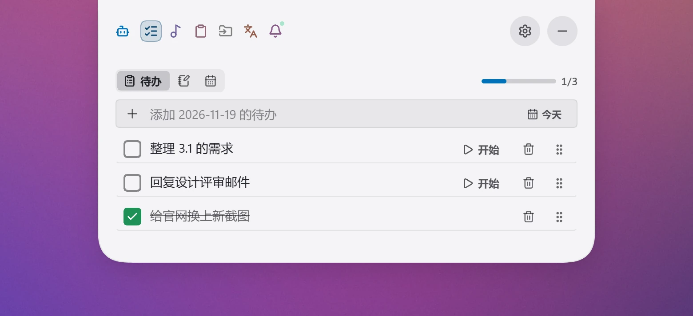
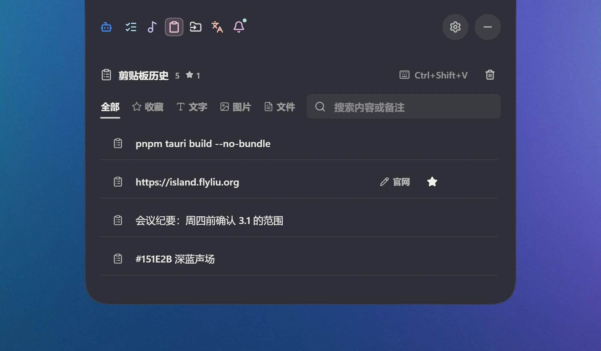
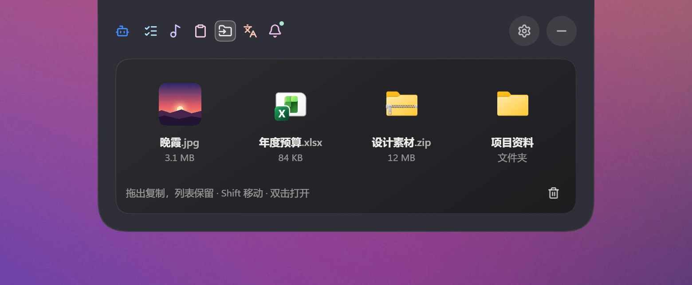
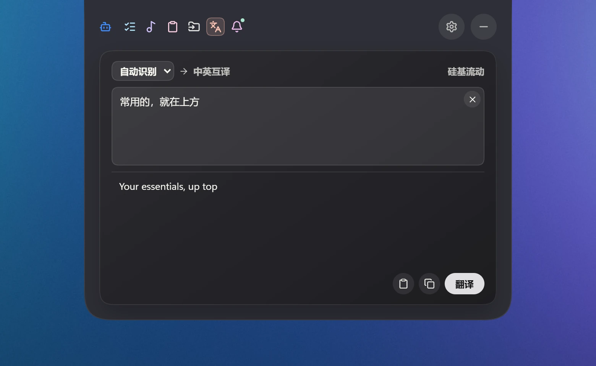
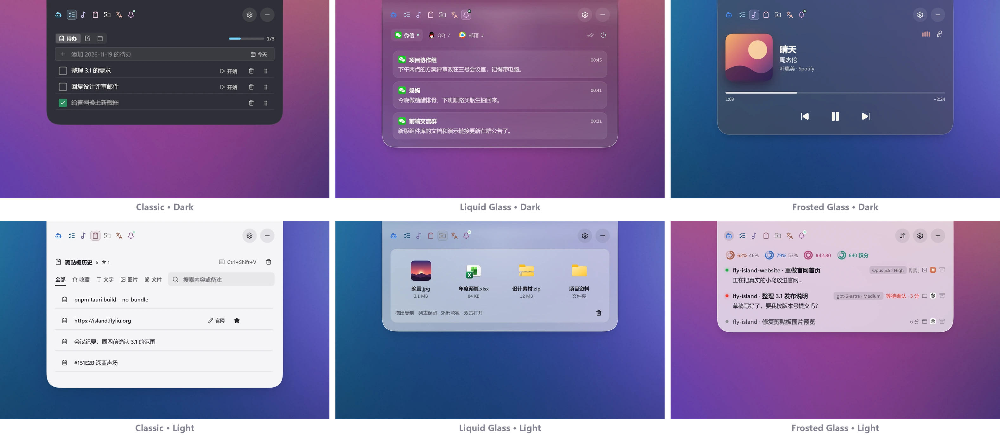
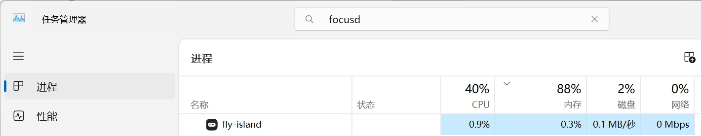

<div align="center">
  

  <h1>fly-island</h1>

  <p>Windows için ultra hafif bir Dynamic Island: WeChat, QQ ve e-posta mesajları, kota halkalı çoklu oturum yapay zekâ ajanları, müzik çalar, yapılacaklar listesi, pano geçmişi, dosya rafı ve daha fazlası. Gerektiğinde genişler, işiniz bittiğinde geri çekilir.</p>

  <p>
    <a href="https://island.flyliu.org/">Canlı Önizleme</a>
    ·
    <a href="https://github.com/flyl1u/fly-island/releases/latest">Sürümü İndir</a>
    ·
    <a href="https://github.com/flyl1u/fly-island/issues">Sorun Bildir</a>
    ·
    <a href="#topluluk">Topluluk</a>
    ·
    <a href="README.en.md">English</a> · <a href="README.md">中文</a> · Türkçe
  </p>

  <p>
    
    
    
    
    
  </p>

  <a href="https://island.flyliu.org/">
    
  </a>

  <p><sub>Kurulum yapmadan denemek için canlı önizlemeye tıklayın (video altyazıları Çincedir)</sub></p>

  <p>Sizi birkaç pencere değiştirmekten kurtardıysa bir ⭐ <b>Yıldız (Star)</b> daha fazla kişinin bulmasına yardımcı olur.</p>
</div>

## Bu nedir?

fly-island, Windows öncelikli bir Dynamic Island uygulamasıdır. WeChat, QQ ve e-posta mesajları doğrudan ada üzerinde belirir. Claude Code, Codex veya DSH'nin ne yaptığını ve onayınızı bekleyip beklemediğini bir bakışta görebilirsiniz. Eşzamanlı şarkı sözleri, dosya rafı, pano geçmişi, hızlı çeviri ve yapılacaklar ekranın üstündeki aynı küçük adada yaşar.

Belleğin yalnızca yaklaşık %0,2–0,5'ini kullanan ultra hafif, çerçevesiz ve her zaman üstte kalan bir adadır. İhtiyacınız olduğunda genişler ve işiniz bittiğinde geri çekilir.

Önce denemek ister misiniz? [Canlı önizleme](https://island.flyliu.org/) gerçek ada arayüzünü demo verilerle çalıştırır ve her yerine tıklayarak deneyebilirsiniz.

## Neden bunu geliştirdim?

Çalışırken veya ders çalışırken yapılacaklar listesini bir uygulamada, gürültüyü bastırmak için müziği başka bir uygulamada, çeviri sitesini üçüncü bir yerde tutuyorum. Gün boyu kod kopyalayıp yapıştırıyor ve hâlâ grup sohbetlerine çekiliyorum. Hepsi arasında geçiş yapmak yavaş ve dikkat dağıtıcı.

iPhone'un Dynamic Island'ı bildirimleri, zamanlayıcıları ve medya kontrollerini tek bir küçük yerde toplar. Windows'ta tüm gün açık tutabileceğim kadar hafif bir araçta aynı deneyimi istedim. İşte fly-island böyle ortaya çıktı.

> Aşağıdaki ekran görüntüleri Çince arayüzü gösterir. Uygulamanın tam İngilizce arayüzü de mevcuttur.

## Çoğu zaman küçücüktür

Kullanmadığınızda ekranın üstünde çalan şarkıyı, okunmamış mesajları ve kaç yapay zekâ ajanının çalıştığını gösteren küçük bir hap şeklindedir.

<p align="center"></p>

Üzerine geldiğinizde aşağıdaki görünümlere genişler.

## Pencere değiştirmeden WeChat, QQ ve e-posta

Yeni mesajlar adada belirir: kimin gönderdiğini ve ne dediğini bir bakışta görürsünüz. Uzun mesajlar adayı genişleterek yerinde okumanızı sağlar. Sessize alınmış grup sohbetleri yalnızca biri sizden `@` ile bahsettiğinde uyarır.

<p align="center"></p>

## Yapay zekâ kodlama araçlarınızın başında beklemeyi bırakın

Her Claude Code ve Codex oturumu adada görünür: hangisi çalışıyor, hangisi bitti, hangisi sizi bekliyor. Kalan Claude / Codex kotanız da oradadır.

<p align="center"></p>

Bir ajan komut çalıştırmak veya dosya düzenlemek istediğinde doğrudan ada üzerinden İzin Ver (Allow) veya Reddet (Deny) düğmesine tıklayın.

<p align="center"></p>

## Müzik ve şarkı sözleri

Hangi oynatıcıyı kullanıyorsanız onu kontrol edin: albüm kapağı, ilerleme, atlama ve eşzamanlı şarkı sözleri. Geçerli satır ada daraltılmışken bile görünür kalır.

<p align="center"></p>

## Bugünün yapılacakları

Bir görev not edin, bittiğinde işaretleyin. Günlük not, takvim ve görev zamanlayıcısı da dahildir.

<p align="center"></p>

## Kopyaladığınız her şey hâlâ orada

Kopyaladığınız metinler, görseller ve dosyalar arayabileceğiniz ve yıldızlayabileceğiniz bir geçmişte tutulur. Tekrar kopyalamak için birine tıklayın. Kısayol: `Ctrl+Shift+V`.

<p align="center"></p>

## Dosya sürüklemek için bir raf

Dosyaları adaya bırakın, pencere değiştirin, sonra ihtiyacınız olan yere sürükleyip bırakın. İki uygulama arasında dosya taşımak için çok pratiktir.

<p align="center"></p>

## Hızlı çeviri

Çince ve İngilizce arasında otomatik çeviri yapmak için `Ctrl+Shift+F` tuşlarına basın. Kayıt veya API anahtarı gerekmeden kutudan çıktığı gibi çalışır.

<p align="center"></p>

## Kendinize göre özelleştirin

Üç görünüm: Classic, Liquid Glass ve Frosted Glass (cam arkasındakini gösterir), her biri koyu ve açık temada. Boyut, renk, köşeler ve yazı tipi de ayarlanabilir.

<p align="center"></p>

## Neredeyse yok gibidir

Her zaman açık olmasından endişelenmeyin: görev yöneticisinde fly-island belleğin yalnızca yaklaşık %0,3'ünü kullanır (yaklaşık 15 GB RAM'li bir Windows dizüstü bilgisayarda test edilmiştir). Müzik yazılımı açtığınızda ve eklenti indirdiğinizde kullanım duruma göre biraz artabilir.

<p align="center"></p>

## Kurulum

1. [Releases](https://github.com/flyl1u/fly-island/releases/latest) sayfasından `fly-island_<version>_x64-setup.exe` dosyasını indirip çalıştırın.
2. Ada ekranınızın üstünde belirir. Başlamak için üzerine gelin.
3. Ayarlar'dan istediğiniz özellikleri açın. Yeni sürümler otomatik kurulur.

<details>
<summary><b>Her özelliği nasıl açarım?</b></summary>

| Özellik | Nasıl? |
| --- | --- |
| WeChat uyarıları | Masaüstü WeChat'te oturumunuzun açık kalması yeterli. [Ayrıntılar](docs/wechat-reminder-compatibility.md) |
| QQ uyarıları | QQ'da oturum açık kalsın ve QQ'da sistem bildirimlerini etkinleştirin. [Ayrıntılar](docs/qq-notification-compatibility.md) |
| E-posta | E-posta kutunuzun web ayarlarından IMAP'ı açın, bir uygulama parolası alın ve Ayarlar → Mail bölümüne girin. [Ayrıntılar](docs/mail.md) |
| Yapay zekâ ajanları | Ayarlar → Agent içinde Install'a tıklayın, ardından terminalinizi yeniden başlatın. [Ayrıntılar](docs/agent-status-hooks.md) |
| Çeviri | Varsayılan olarak çalışır. DeepSeek, Qwen, OpenAI ve diğer modelleri kullanmak için Ayarlar → Translation bölümüne API anahtarı ekleyin |

</details>

<details>
<summary><b>Verilerim güvende mi?</b></summary>

Yapılacaklar, pano geçmişi ve ayarlar kendi bilgisayarınızda kalır. WeChat ve QQ mesajları yalnızca bellekte tutulur ve çıktığınızda silinir. E-posta gövdeleri yalnızca siz açtığınızda çekilir ve asla okundu olarak işaretlenmez. Parolalar ve anahtarlar Windows Credential Manager içinde saklanır.

</details>

## Topluluk

Kullanıcı grubuna (çoğunlukla Çince konuşulan) katılmak için QR kodunu WeChat ile tarayın. Bunu uygulamada Ayarlar → Hakkında altında da bulabilirsiniz. İngilizce geri bildirimlerinizi [Issues](https://github.com/flyl1u/fly-island/issues) üzerinden paylaşabilirsiniz.

<p align="center"></p>

<p align="center"><sub>QR kodu 30 Kasım'a kadar geçerlidir. Süresi dolduysa lütfen bir <a href="https://github.com/flyl1u/fly-island/issues">Issue</a> açarak bildirin.</sub></p>

<details>
<summary><b>Katkıda Bulunma</b></summary>

### Kaynak koddan çalıştırma

Windows 10/11, Git, Node.js, pnpm, Rust, Visual Studio C++ Build Tools ve WebView2 Runtime gerekir.

```powershell
git clone https://github.com/flyl1u/fly-island.git
cd fly-island
pnpm install
pnpm tauri dev
```

### Değişiklik gönderme

Commit atmadan önce `pnpm check` çalıştırın. Depo kuralları için [AGENTS.md](AGENTS.md) ve sürüm adımları için [sürüm kılavuzuna](docs/updater.md) bakın.

### Eklenti geliştirme

Eklentinizi yerelde test edin, ardından bir demo kaydı, geliştirici adı ve iletişim bilgileriyle PR açın. Eklentiler incelemeden sonra yayımlanır. Bkz. [eklenti geliştirme kılavuzu](docs/plugins/README.md).

</details>

## Teşekkürler

Geçmiş katkıda bulunanlara teşekkürler: [TixXin](https://github.com/TixXin) ve [ShengLin1001](https://github.com/ShengLin1001).

Eklenti katkıda bulunanlarına teşekkürler:

- Eye Care: [zloghs](https://github.com/zloghs) ([#92](https://github.com/flyl1u/fly-island/pull/92))
- Telegram: [baiyu0111 (云奇)](https://github.com/baiyu0111) ([#134](https://github.com/flyl1u/fly-island/pull/134))
- CodeBuddy: [yiumanlenong](https://github.com/yiumanlenong) ([#125](https://github.com/flyl1u/fly-island/pull/125))
- Antigravity: [lilipeng0615-cyber](https://github.com/lilipeng0615-cyber) ([#120](https://github.com/flyl1u/fly-island/pull/120))
- MiniMax Code: [YTC0408](https://github.com/YTC0408) ([#110](https://github.com/flyl1u/fly-island/pull/110))
- Device Battery & Audio: [Anobod1119](https://github.com/Anobod1119) ([#106](https://github.com/flyl1u/fly-island/pull/106))

## Yıldız Geçmişi

<a href="https://www.star-history.com/?repos=flyl1u%2Ffly-island&type=date&legend=top-left">
  <picture>
    <source media="(prefers-color-scheme: dark)" srcset="https://api.star-history.com/chart?repos=flyl1u/fly-island&type=date&theme=dark&legend=top-left" />
    <source media="(prefers-color-scheme: light)" srcset="https://api.star-history.com/chart?repos=flyl1u/fly-island&type=date&theme=light&legend=top-left" />
    
  </picture>
</a>
