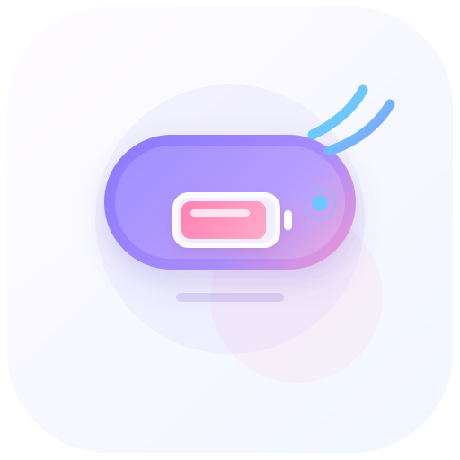

# 设备电量与音频 / Device battery & audio

<p align="center"></p>

Fly Island 源码插件：岛上和设置各有独立「设备」页，集中查看无线电量并切换扬声器 / 耳机。岛上使用用户指定的 MyFinder 双列设备卡片作为布局参考。默认关闭；它独立于尚未上线的 AI 数据接入插件市场，不改变 `release-features.json`。

**支持的鼠标 / 耳机型号见 [MODELS.md](MODELS.md)。**

## 构建与使用

Windows x64，使用系统 .NET Framework 编译器；首次构建需要网络。

```powershell
pnpm install --frozen-lockfile
pnpm plugin:device-battery
pnpm tauri dev
```

1. 复制构建输出的绝对目录（默认 `artifacts/device-battery`）。
2. 在「设置 → 设备」的本地插件目录中粘贴、保存，再启用。原先保存在插件页的目录、开关与绑定会继续使用。
3. 从活动音频输出中分别绑定扬声器和耳机；不自动猜测设备，不修改麦克风。
4. 展开小岛，点顶部耳机图标进入「设备」页，查看电量卡片、切换音源，或点「设备设置」回到绑定页。设备页的绑定选择自动保存 / 更新，无需手动刷新；重复保存相同目录保留开关和绑定。电量低于 20% 且未在充电时，折叠岛会显示一次提醒（充电或回升到 30% 后重新武装）。
5. 关闭插件即停止后续查询。已开始的单次读取最多约 62 秒内结束；宿主退出时查询进程及其子进程一并结束。

这是可关闭的源码集成与本地独立插件包，尚未发布到在线市场，不支持直接用现有 JSON-RPC「本地插件目录」加载。需要另一个小岛安装使用时，复制**整个**输出文件夹，在新的设备插件设置中指定该目录。仅信任自己的构建或可信来源；目录内程序具有当前用户权限。

`build.ps1 -SkipRuntime` 仅适合音频和两个原生电量读取器调试；缺少便携 Python 时明确报告通用读取器不可用，不显示虚构电量。发行插件应运行完整构建。exe、下载缓存和 Python 运行库不进入 Git。

## 复用范围与接入点

- 上游：`wushuai0802/myfinder-device-battery`，固定提交 `73d99e2087dd70ae8eef4199854e0c495a66f0bc`（本地提供的源码）。`upstream/engine/`、三个 C# 读取 / 控制文件和两个构建辅助脚本原样保留。
- `SOURCE.json` 记录 151 个上游文件的 SHA-256；另保留原测试依赖的 `upstream/tests/test_engine_reliability.py`。离线协议自测运行 `powershell.exe -NoProfile -File plugins/device-battery/test.ps1`。
- 新增 `Bridge.cs` 和最小音频绑定类：只开放查询、枚举、音源切换；不开放 DPI、固件、配对、更新、托盘或自启接口。不读 MyFinder 用户配置。
- `src/features/device-battery/`：设置持久化、请求、状态、岛上 `DeviceDashboard` 卡片页与低电量折叠提醒。`src-tauri/src/device_battery/`：固定入口、参数检查、共享扫描 / 缓存、输出上限与进程树超时回收。
- 原有文件接入点：设置分类 / 侧栏 / `SettingsPanel.tsx`、`src-tauri/src/lib.rs`、i18n 汇总和构建 / 测试入口。设备页由 `DevicesSettingsPage.tsx` 组合，原插件页不再挂载设备功能。
- 插件目录由用户显式指定；后端只调用其中固定名称的 helper 和便携 Python，以参数数组启动、不经 shell。

音频切换沿用上游：只改变 Console 和 Multimedia 默认输出，读回核验，失败尝试恢复，Communications 与录音默认设备保持不变。绑定端点不在活动列表时按钮禁用。音频端点在线不代表无线耳机已开机。

设备协议、型号限制和验证等级沿用上游，不保证全品牌全系列；型号清单见 [MODELS.md](MODELS.md)。未知值保留为未知，历史值和估算单独标记。只在设备页 / 音乐页显示时读取，电量间隔 60 秒；音频每 5 秒、窗口获得焦点和绑定改变后自动检查。改选音频不会重启电量查询或清空已有列表。引擎单次进程不保留跨轮设备缓存，系统自身缓存依然可能存在。同一插件目录的多窗口会共享一轮电量扫描和增量读数；最近 10 分钟的已读数据会先作为缓存显示，再由新扫描更新。音频查询仍由后端依次处理。

## 文件、网络与许可

运行时仅访问用户指定的插件目录、Windows 音频 API 与 HID / 蓝牙设备；不联网、不读取账号，不启用数据包在线更新。用户偏好存到新的 `focusd-island-device-battery` localStorage key。

首次构建由上游锁文件下载固定版本 CPython 和 hidapi，校验 SHA-256，并验证 Python 可执行文件的 Windows 签名；原始许可与第三方声明位于 `upstream/LICENSE`、`upstream/THIRD_PARTY_NOTICES.md`、`upstream/engine/licenses/`。MyFinder 部分保留 AGPL-3.0-only，上游 HaloBattery 部分保留原 MIT 许可，不修改 Fly Island 根许可证。独立进程插件分发时必须保留相应源码和许可。

验证命令与实际结果见 [集成说明](../../docs/device-battery.md)。在向上游提交插件 PR 之前，仍需真实小岛交互录屏、设备与厂商软件共存验收，以及作者和公开联系方式；本次不会代填私人信息或宣称所有硬件已验证。

## English

An optional Fly Island source plugin adds dedicated Devices pages to the island and Settings. The island's headphone button opens a grid of device battery cards based on the supplied MyFinder UI reference, with output switching and a link to configuration. A low level (≤20%) off the charger shows a one-time alert on the collapsed island. Build with `pnpm plugin:device-battery`, save the generated folder under Settings → Devices, enable it and bind two active outputs. Existing preferences are preserved. Binding changes automatically refresh audio without clearing the device list or restarting battery reads. Saving an unchanged folder preserves bindings. Default is off; the existing JSON-RPC loader and release flags are unchanged. This local package has not been published to the online market. See [MODELS.md](MODELS.md) for supported mice and headsets.

The independent headless bridge preserves the pinned MyFinder implementation and licenses. It exposes only audio enumeration/switching and battery queries, with verified audio readback, rollback, timeouts and owned process-tree cleanup. It preserves communications/recording defaults and never launches the MyFinder UI. Unknown values are not fabricated; estimates and cached readings are labelled. Hardware support and verification limits remain those of the upstream source.

Only visible panels poll: batteries every 60 seconds, audio every 5 seconds and on focus/binding changes. Concurrent battery requests for the same directory share one scan and its latest partial snapshot. A completed battery snapshot is replayed as cached data for up to 10 minutes while a new scan runs. Disabling prevents subsequent polling; a scan already in progress completes for remaining subscribers. Active battery reads can take up to approximately 62 seconds. Overlapping audio queries wait for the previous timed operation. Runtime operations are offline. The initial build downloads hash-pinned Python/hidapi and verifies the Python signature. Copy the complete output directory for another installation; load only trusted local code. Generated binaries, runtimes and downloads are excluded from Git. Keep the AGPL and MIT notices/source obligations when distributing the plugin.
